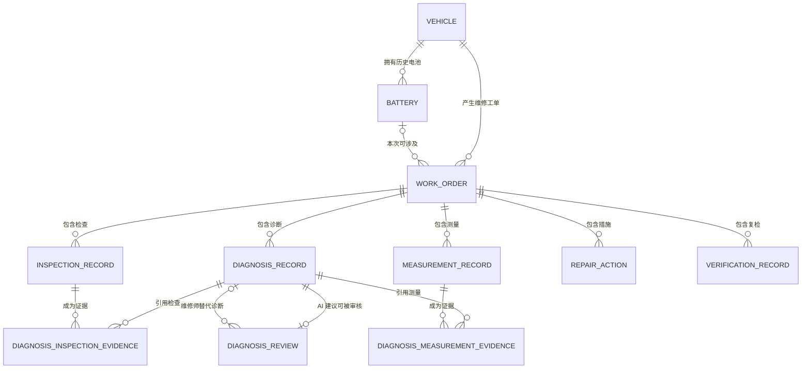

# 第 10 天：维修业务逻辑表结构草案

## 1. 目标、依据与边界

本文把 [第 9 天概念模型](./day9-domain-model.md) 中的九个业务实体转换为可评审的 MySQL 逻辑表结构，明确字段职责、候选类型、主键、外键、可空性、状态含义、关系约束和索引用途。

本次只形成设计草案，不连接 MySQL，不编写建表 DDL，不选择 ORM，也不修改现有 API。字段类型是面向 MySQL 的候选类型；字符长度、数值精度和约束语法仍需在真正建库前结合 MySQL 版本与样本数据复核。

设计继续遵守以下证据边界：

- 只保存项目内部匿名编号，不保存姓名、手机号、车牌等无关个人信息。
- 未知事实保存为 `NULL`，不能用 `0`、空字符串或当前时间冒充。
- 没有发生测量时不创建测量记录；真实仪表读数为 `0` 时，`0` 是合法测量值。
- AI 只能产生待审核建议，不能直接成为维修师最终结论或已确认维修结果。
- 维修动作与复检证据分别保存；“实施过维修”不能自动推出“故障已解决”。

## 2. 通用设计约定

### 2.1 主键、业务编号与命名

- 每张实体表使用 `BIGINT UNSIGNED` 类型的内部 `id` 作为主键，未来物理设计可采用自增生成。
- `vehicle_code`、`battery_code`、`work_order_no` 是面向维修业务和界面展示的稳定编号，分别设置唯一约束，但不作为表间外键。
- 表名和字段名使用小写蛇形命名。主表采用单数名称，过程明细表以 `_record` 或业务名称结尾。
- 两张多对多关联表不增加无业务含义的独立 `id`，直接使用两个外键组成复合主键。

内部主键与业务编号承担不同职责：内部 `id` 只负责数据库关联，不向业务人员表达编号规则；业务编号可以按展示需求生成，但编号规则变化时不需要修改所有外键。

### 2.2 空值、时间与来源

- 所有表（包括两张证据关联表）都包含非空的 `created_at` 和 `updated_at`，候选类型为 `DATETIME(6)`；后续实现统一按 UTC 保存，界面按 `Asia/Shanghai` 展示。
- `event_at` 表示检查、测量、诊断、维修或复检实际发生时间。历史案例可能无法确认准确时间，因此数据库层允许为 `NULL`；新系统产生记录时应尽量填写。
- `created_at` 只表示系统何时写入记录，不能代替未知的历史 `event_at`。
- 需要追溯来源的记录保存稳定的 `source_type` 代码和可空的 `source_note`。第一版不建立人员账号表，也不在备注中收集无关身份信息。

### 2.3 状态、删除与约束层次

- 状态字段使用 `VARCHAR(32)` 保存稳定英文代码，并在逻辑设计中列出允许值；暂不采用 MySQL `ENUM` 或独立状态字典表。
- 本阶段不设计统一 `deleted_at`。已产生的工单和维修证据通过完成或取消状态保留，父记录外键采用限制删除，不级联物理删除。
- 数据库负责主键、唯一约束、非空约束、单表检查和普通外键。
- 需要同时读取多张表才能判断的规则由后续 Service 层在事务中校验，不能假装普通外键已经覆盖。

## 3. 逻辑表结构

下表中的“空值”表示数据库层是否允许 `NULL`。“非空”不代表可以写入空字符串；后续 API 仍需校验去除空白后的文本内容。

### 3.1 `vehicle`：车辆

| 字段 | 候选类型 | 空值 | 键 / 约束 | 含义 |
|---|---|---|---|---|
| `id` | `BIGINT UNSIGNED` | 非空 | 主键 | 数据库内部车辆标识 |
| `vehicle_code` | `VARCHAR(32)` | 非空 | 唯一 | 项目内匿名车辆编号，如 `V-001` |
| `brand` | `VARCHAR(100)` | 可空 |  | 实际已知的车辆品牌 |
| `model` | `VARCHAR(100)` | 可空 |  | 实际已知的车辆型号 |
| `notes` | `TEXT` | 可空 |  | 与维修有关且无法结构化的补充信息 |
| `created_at` | `DATETIME(6)` | 非空 |  | 系统创建时间 |
| `updated_at` | `DATETIME(6)` | 非空 |  | 系统最后更新时间 |

车辆资料不完整不妨碍建立匿名车辆和维修工单。第一版不保存车主姓名、联系方式或车牌。

### 3.2 `battery`：电池

| 字段 | 候选类型 | 空值 | 键 / 约束 | 含义 |
|---|---|---|---|---|
| `id` | `BIGINT UNSIGNED` | 非空 | 主键 | 数据库内部电池标识 |
| `battery_code` | `VARCHAR(32)` | 非空 | 唯一 | 系统分配的匿名电池编号 |
| `vehicle_id` | `BIGINT UNSIGNED` | 非空 | 外键 → `vehicle.id` | 当前记录所属车辆 |
| `chemistry` | `VARCHAR(50)` | 可空 |  | 实际确认的电池类型；未知时不推断 |
| `nominal_voltage_v` | `DECIMAL(10,3)` | 可空 | 非负 | 铭牌或可靠资料中的标称电压，不是实测值 |
| `nominal_capacity_ah` | `DECIMAL(10,3)` | 可空 | 非负 | 铭牌或可靠资料中的标称容量，不是实测值 |
| `specification_note` | `TEXT` | 可空 |  | 其他已知规格，不固定为三串电芯结构 |
| `source_type` | `VARCHAR(32)` | 非空 | 允许值见第 4 节 | 规格信息主要来源 |
| `source_note` | `TEXT` | 可空 |  | 铭牌、维修师观察或历史资料的补充说明 |
| `created_at` | `DATETIME(6)` | 非空 |  | 系统创建时间 |
| `updated_at` | `DATETIME(6)` | 非空 |  | 系统最后更新时间 |

车辆更换电池时建立新的电池记录，历史工单继续关联当时涉及的电池。本阶段不增加容易产生冲突的 `is_current` 标志。

### 3.3 `work_order`：维修工单

| 字段 | 候选类型 | 空值 | 键 / 约束 | 含义 |
|---|---|---|---|---|
| `id` | `BIGINT UNSIGNED` | 非空 | 主键 | 数据库内部工单标识 |
| `work_order_no` | `VARCHAR(32)` | 非空 | 唯一 | 面向业务展示的工单编号 |
| `vehicle_id` | `BIGINT UNSIGNED` | 非空 | 外键 → `vehicle.id` | 本次维修所属车辆 |
| `battery_id` | `BIGINT UNSIGNED` | 可空 | 外键 → `battery.id` | 本次维修涉及的电池；不涉及或未知时为空 |
| `reported_symptom` | `TEXT` | 非空 | 非空文本 | 接车时报告的故障现象和已知触发情境 |
| `report_source` | `VARCHAR(32)` | 非空 | 允许值见第 4 节 | 接车描述的来源类型 |
| `report_source_note` | `TEXT` | 可空 |  | 来源和确认状态的补充说明 |
| `status` | `VARCHAR(32)` | 非空 | 允许值见第 4 节 | 当前维修流程阶段 |
| `completion_outcome` | `VARCHAR(32)` | 可空 | 条件约束 | 完工结果；仅 `COMPLETED` 时填写 |
| `received_at` | `DATETIME(6)` | 可空 |  | 实际接车时间；历史未知时为空 |
| `completed_at` | `DATETIME(6)` | 可空 | 条件约束 | 实际完工时间；历史未知时可为空 |
| `cancel_reason` | `TEXT` | 可空 | 条件约束 | 取消原因；新工单转为 `CANCELLED` 时必填 |
| `notes` | `TEXT` | 可空 |  | 不能归入其他字段的工单说明 |
| `created_at` | `DATETIME(6)` | 非空 |  | 系统创建时间 |
| `updated_at` | `DATETIME(6)` | 非空 |  | 系统最后更新时间 |

逻辑约束：

- `completion_outcome` 仅在 `status = COMPLETED` 时非空，其他状态必须为空。
- 新系统工单进入 `COMPLETED` 时要求填写 `completed_at`；导入历史案例时可以保留未知。
- 新系统工单进入 `CANCELLED` 时要求填写 `cancel_reason`，且不得填写完工结果。
- `battery_id` 非空时，对应电池的 `vehicle_id` 必须等于本工单的 `vehicle_id`；该规则需要 Service 层跨表校验。

### 3.4 `inspection_record`：检查记录

| 字段 | 候选类型 | 空值 | 键 / 约束 | 含义 |
|---|---|---|---|---|
| `id` | `BIGINT UNSIGNED` | 非空 | 主键 | 检查记录标识 |
| `work_order_id` | `BIGINT UNSIGNED` | 非空 | 外键 → `work_order.id` | 所属工单 |
| `inspection_item` | `VARCHAR(100)` | 非空 | 非空文本 | 检查对象或项目 |
| `method` | `TEXT` | 可空 |  | 已知的检查方法或动作 |
| `observation` | `TEXT` | 可空 |  | 实际观察结果；历史结果未记录时为空 |
| `source_type` | `VARCHAR(32)` | 非空 | 允许值见第 4 节 | 检查信息来源 |
| `source_note` | `TEXT` | 可空 |  | 来源和确认状态的补充说明 |
| `event_at` | `DATETIME(6)` | 可空 |  | 实际检查时间 |
| `created_at` | `DATETIME(6)` | 非空 |  | 系统创建时间 |
| `updated_at` | `DATETIME(6)` | 非空 |  | 系统最后更新时间 |

已确认“执行过检查”但不知道当时结果时，可以建立检查记录并让 `observation` 为 `NULL`；不能自动补成“正常”“异常”或“未通过”。

### 3.5 `measurement_record`：测量记录

| 字段 | 候选类型 | 空值 | 键 / 约束 | 含义 |
|---|---|---|---|---|
| `id` | `BIGINT UNSIGNED` | 非空 | 主键 | 测量记录标识 |
| `work_order_id` | `BIGINT UNSIGNED` | 非空 | 外键 → `work_order.id` | 所属工单 |
| `target_type` | `VARCHAR(32)` | 非空 | 稳定代码 | 测量对象类别，如电池、单体、转换器或其他部件 |
| `target_label` | `VARCHAR(100)` | 非空 | 非空文本 | 具体测点或对象名称，不固定为 `cell1`–`cell3` |
| `metric_code` | `VARCHAR(50)` | 非空 | 稳定代码 | 测量项目，如电压、电流或电阻 |
| `measurement_value` | `DECIMAL(18,6)` | 非空 | 数值 | 实际测得数值；真实 `0` 允许保存 |
| `unit_code` | `VARCHAR(20)` | 非空 | 非空文本 | 与数值配套的单位代码 |
| `condition_note` | `TEXT` | 可空 |  | 空载、带载、修前、修后等已知测量条件 |
| `source_type` | `VARCHAR(32)` | 非空 | 允许值见第 4 节 | 仪器、ESP32、导入记录等来源 |
| `source_reference` | `TEXT` | 可空 |  | 原始日志、设备或历史资料引用；不得包含密钥 |
| `event_at` | `DATETIME(6)` | 可空 |  | 实际测量时间 |
| `created_at` | `DATETIME(6)` | 非空 |  | 系统创建时间 |
| `updated_at` | `DATETIME(6)` | 非空 |  | 系统最后更新时间 |

只知道“曾经测过”但数值和单位均未记录时，不创建测量记录。定量复检仍可建立测量记录，并在 `condition_note` 标明修后条件；复检对效果的判断另存于 `verification_record`。

### 3.6 `diagnosis_record`：诊断记录

| 字段 | 候选类型 | 空值 | 键 / 约束 | 含义 |
|---|---|---|---|---|
| `id` | `BIGINT UNSIGNED` | 非空 | 主键 | 诊断记录标识 |
| `work_order_id` | `BIGINT UNSIGNED` | 非空 | 外键 → `work_order.id` | 所属工单 |
| `producer_type` | `VARCHAR(32)` | 非空 | `AI` / `TECHNICIAN` | 诊断产生者类型 |
| `conclusion_stage` | `VARCHAR(32)` | 非空 | 允许值见第 4 节 | 建议、初步判断或最终判断 |
| `conclusion_text` | `TEXT` | 非空 | 非空文本 | 当时产生的诊断内容，后续审核不能覆盖原文 |
| `basis_note` | `TEXT` | 可空 |  | 无法通过结构化关联表达的已知依据说明 |
| `uncertainty_note` | `TEXT` | 可空 |  | 缺失证据、待复检项或不确定性 |
| `model_name` | `VARCHAR(100)` | 可空 | 条件约束 | AI 诊断所用模型；历史未知时可空 |
| `prompt_version` | `VARCHAR(100)` | 可空 | 条件约束 | AI 诊断所用提示词版本；历史未知时可空 |
| `source_type` | `VARCHAR(32)` | 非空 | 允许值见第 4 节 | 诊断内容进入系统时的来源 |
| `source_note` | `TEXT` | 可空 |  | 来源和确认状态的补充说明 |
| `event_at` | `DATETIME(6)` | 可空 |  | 实际产生诊断的时间 |
| `created_at` | `DATETIME(6)` | 非空 |  | 系统创建时间 |
| `updated_at` | `DATETIME(6)` | 非空 |  | 系统最后更新时间 |

逻辑约束：

- `producer_type = AI` 时，`conclusion_stage` 只能为 `SUGGESTION`。
- `producer_type = TECHNICIAN` 时，`conclusion_stage` 只能为 `PRELIMINARY` 或 `FINAL`。
- 新系统产生 AI 诊断时应记录模型与 Prompt 版本；数据库允许为空只是为了兼容信息不全的历史导入。

### 3.7 `diagnosis_review`：诊断审核

| 字段 | 候选类型 | 空值 | 键 / 约束 | 含义 |
|---|---|---|---|---|
| `id` | `BIGINT UNSIGNED` | 非空 | 主键 | 审核记录标识 |
| `reviewed_diagnosis_id` | `BIGINT UNSIGNED` | 非空 | 唯一外键 → `diagnosis_record.id` | 被审核的 AI 建议；保证最多一条当前审核 |
| `decision` | `VARCHAR(32)` | 非空 | 允许值见第 4 节 | 接受、修正或驳回 |
| `review_note` | `TEXT` | 可空 | 条件约束 | 审核理由；修正或驳回时必填 |
| `replacement_diagnosis_id` | `BIGINT UNSIGNED` | 可空 | 外键 → `diagnosis_record.id` | 修正后的维修师诊断 |
| `event_at` | `DATETIME(6)` | 可空 |  | 实际审核时间 |
| `created_at` | `DATETIME(6)` | 非空 |  | 系统创建时间 |
| `updated_at` | `DATETIME(6)` | 非空 |  | 当前审核最后更新时间 |

逻辑约束：

- `reviewed_diagnosis_id` 必须指向 `producer_type = AI` 的 `SUGGESTION`。
- `ACCEPTED` 不填写替代诊断；`CORRECTED` 必须填写替代诊断；`REJECTED` 可以在尚无替代结论时保持为空。
- 替代诊断必须由维修师产生，并且与被审核诊断属于同一工单。
- 第一版只保留一条当前审核，后续更正更新该行和 `updated_at`；暂不实现审核版本历史。

这些条件涉及被引用行的字段，普通外键无法完成，需要 Service 层在事务中校验。

### 3.8 `repair_action`：维修措施

| 字段 | 候选类型 | 空值 | 键 / 约束 | 含义 |
|---|---|---|---|---|
| `id` | `BIGINT UNSIGNED` | 非空 | 主键 | 维修措施标识 |
| `work_order_id` | `BIGINT UNSIGNED` | 非空 | 外键 → `work_order.id` | 所属工单 |
| `action_type` | `VARCHAR(32)` | 非空 | 允许值见第 4 节 | 更换、维修、调整、清洁、整理线路或其他实际动作 |
| `description` | `TEXT` | 非空 | 非空文本 | 实际完成的维修动作 |
| `part_name` | `VARCHAR(100)` | 可空 |  | 实际处理或更换的部件名称 |
| `part_specification` | `TEXT` | 可空 |  | 实际已知的部件规格 |
| `source_type` | `VARCHAR(32)` | 非空 | 允许值见第 4 节 | 维修措施记录的来源 |
| `source_note` | `TEXT` | 可空 |  | 来源和确认状态的补充说明 |
| `event_at` | `DATETIME(6)` | 可空 |  | 实际实施时间 |
| `created_at` | `DATETIME(6)` | 非空 |  | 系统创建时间 |
| `updated_at` | `DATETIME(6)` | 非空 |  | 系统最后更新时间 |

只记录实际实施的动作。AI 或维修师提出但没有执行的建议不能写入本表。

### 3.9 `verification_record`：复检记录

| 字段 | 候选类型 | 空值 | 键 / 约束 | 含义 |
|---|---|---|---|---|
| `id` | `BIGINT UNSIGNED` | 非空 | 主键 | 复检记录标识 |
| `work_order_id` | `BIGINT UNSIGNED` | 非空 | 外键 → `work_order.id` | 所属工单 |
| `verification_item` | `VARCHAR(100)` | 非空 | 非空文本 | 复检的功能、部件或项目 |
| `method` | `TEXT` | 非空 | 非空文本 | 如何执行复检 |
| `result_text` | `TEXT` | 非空 | 非空文本 | 实际观察或结果，不扩大为整车安全结论 |
| `outcome` | `VARCHAR(32)` | 非空 | `PASS` / `FAIL` / `PARTIAL` | 本项复检结论 |
| `remaining_issue` | `TEXT` | 可空 |  | 未解决问题或后续建议 |
| `source_type` | `VARCHAR(32)` | 非空 | 允许值见第 4 节 | 复检结果来源 |
| `source_note` | `TEXT` | 可空 |  | 来源和确认状态的补充说明 |
| `event_at` | `DATETIME(6)` | 可空 |  | 实际复检时间 |
| `created_at` | `DATETIME(6)` | 非空 |  | 系统创建时间 |
| `updated_at` | `DATETIME(6)` | 非空 |  | 系统最后更新时间 |

若复检包含结构化数值，应同时建立 `measurement_record` 保存数值和单位；本表保存复检方法、范围及效果判断。是否增加复检与测量的直接关联，要等待更多真实案例后再决定，本阶段不提前增加第三张证据关联表。

### 3.10 `diagnosis_inspection_evidence`：诊断引用检查证据

| 字段 | 候选类型 | 空值 | 键 / 约束 | 含义 |
|---|---|---|---|---|
| `diagnosis_id` | `BIGINT UNSIGNED` | 非空 | 复合主键；外键 → `diagnosis_record.id` | 引用证据的诊断 |
| `inspection_record_id` | `BIGINT UNSIGNED` | 非空 | 复合主键；外键 → `inspection_record.id` | 被引用的检查记录 |
| `created_at` | `DATETIME(6)` | 非空 |  | 系统创建关联的时间 |
| `updated_at` | `DATETIME(6)` | 非空 |  | 系统最后更新时间 |

两个外键必须属于同一工单。普通外键只能证明两条记录分别存在，无法证明 `work_order_id` 相同，因此需要 Service 层校验。

### 3.11 `diagnosis_measurement_evidence`：诊断引用测量证据

| 字段 | 候选类型 | 空值 | 键 / 约束 | 含义 |
|---|---|---|---|---|
| `diagnosis_id` | `BIGINT UNSIGNED` | 非空 | 复合主键；外键 → `diagnosis_record.id` | 引用证据的诊断 |
| `measurement_record_id` | `BIGINT UNSIGNED` | 非空 | 复合主键；外键 → `measurement_record.id` | 被引用的测量记录 |
| `created_at` | `DATETIME(6)` | 非空 |  | 系统创建关联的时间 |
| `updated_at` | `DATETIME(6)` | 非空 |  | 系统最后更新时间 |

两个外键同样必须属于同一工单。独立关联表可以使用真实外键并支持双向查询；将证据 ID 塞入 JSON 数组会失去外键完整性、去重约束和稳定联查能力。

## 4. 状态代码与业务规则

### 4.1 工单状态机

| 状态 | 含义 |
|---|---|
| `RECEIVED` | 已建立工单并记录接车现象，尚未开始检查 |
| `INSPECTING` | 正在检查或测量 |
| `DIAGNOSING` | 正在形成或审核诊断 |
| `REPAIRING` | 正在实施维修措施 |
| `VERIFYING` | 正在进行修后复检 |
| `COMPLETED` | 本工单流程已经结束，并已记录完工结果 |
| `CANCELLED` | 本工单已中止，不作为已完成维修 |

正常流程为：

```text
RECEIVED → INSPECTING → DIAGNOSING → REPAIRING → VERIFYING → COMPLETED
```

状态转换规则：

- 实际流程中不适用的中间阶段可以向前跳过，但进入 `COMPLETED` 前仍须满足完工约束。
- 复检失败后可以从 `VERIFYING` 返回 `DIAGNOSING` 或 `REPAIRING`，保留已经产生的历史记录。
- 任意非终态可以转为 `CANCELLED`；新系统必须记录取消原因。
- `COMPLETED` 和 `CANCELLED` 是终态，不直接重新打开。车辆返店时建立新工单，以保留两次维修经历。
- 后续实现必须由 Service 层集中执行状态转换，避免接口直接任意改写状态。

### 4.2 完工结果

| 代码 | 含义 |
|---|---|
| `REPAIRED` | 本工单约定的故障范围已通过复检，不代表整车所有系统安全 |
| `PARTIAL` | 部分目标恢复，仍存在已记录问题 |
| `UNRESOLVED` | 流程结束但故障未解决 |
| `NO_FAULT_FOUND` | 在已执行检查范围内没有复现或确认故障，不等于车辆绝对无故障 |

`REPAIRED` 或 `PARTIAL` 必须至少有一条复检记录支撑，并由维修师确认最终结果。数据库无法用普通行约束检查子表是否存在，需要 Service 层在同一事务中校验。`UNRESOLVED` 和 `NO_FAULT_FOUND` 也必须有检查、诊断或备注说明，不能只改状态。

### 4.3 其他稳定代码

| 字段 | 第一版允许值 |
|---|---|
| `work_order.report_source` | `CUSTOMER_STATEMENT`、`TECHNICIAN_OBSERVATION`、`HISTORICAL_RECOLLECTION`、`IMPORTED_RECORD`、`OTHER` |
| `battery.source_type` | `NAMEPLATE`、`CUSTOMER_STATEMENT`、`TECHNICIAN_OBSERVATION`、`HISTORICAL_RECOLLECTION`、`IMPORTED_RECORD`、`OTHER` |
| `inspection_record.source_type` | `TECHNICIAN_OBSERVATION`、`HISTORICAL_RECOLLECTION`、`IMPORTED_RECORD`、`OTHER` |
| `measurement_record.source_type` | `MANUAL_INSTRUMENT`、`ESP32`、`SIMULATOR`、`IMPORTED_RECORD`、`OTHER` |
| `diagnosis_record.source_type` | `LIVE_AGENT`、`TECHNICIAN_OBSERVATION`、`HISTORICAL_RECOLLECTION`、`IMPORTED_RECORD`、`OTHER` |
| `repair_action.source_type` | `TECHNICIAN_OBSERVATION`、`HISTORICAL_RECOLLECTION`、`IMPORTED_RECORD`、`OTHER` |
| `verification_record.source_type` | `TECHNICIAN_OBSERVATION`、`DEVICE`、`HISTORICAL_RECOLLECTION`、`IMPORTED_RECORD`、`OTHER` |
| `producer_type` | `AI`、`TECHNICIAN` |
| `conclusion_stage` | `SUGGESTION`、`PRELIMINARY`、`FINAL` |
| `diagnosis_review.decision` | `ACCEPTED`、`CORRECTED`、`REJECTED` |
| `repair_action.action_type` | `REPLACE`、`REPAIR`、`ADJUST`、`CLEAN`、`REWIRE`、`OTHER` |
| `verification_record.outcome` | `PASS`、`FAIL`、`PARTIAL` |

`target_type`、`metric_code` 和 `unit_code` 也保存稳定代码，但当前真实案例不足，暂不假设完整代码表。正式建库前应依据新增案例列出最小集合并明确单位规范，不能让模型自由创造代码。

## 5. 关系与约束归属



| 规则 | 数据库可直接保证 | 后续 Service 层负责 |
|---|---|---|
| 编号不重复 | 唯一约束 | 生成可读编号并处理并发冲突 |
| 明细所属工单存在 | 外键 | 新增前检查工单是否允许继续写入 |
| 工单电池属于同一车辆 | 两个外键只能保证各自的行存在 | 比较 `battery.vehicle_id` 与 `work_order.vehicle_id` |
| 诊断引用同工单证据 | 两个外键和复合主键 | 比较诊断与证据的 `work_order_id` |
| 只审核 AI 建议 | 审核外键和唯一约束 | 检查被审核诊断的产生者与阶段 |
| 修正诊断归属正确 | 替代诊断外键 | 检查产生者、阶段和工单一致性 |
| 完工结果有复检支撑 | 单表可检查结果字段是否为空 | 查询复检记录并在事务内完成状态转换 |
| 禁止误删历史 | 外键限制父记录删除 | 不提供常规物理删除接口并记录取消状态 |

## 6. 候选索引及查询目的

外键列在物理建表时都需要相应索引。除主键和外键索引外，第一版只保留有明确查询场景的候选索引：

| 表 | 候选索引 | 服务的查询 |
|---|---|---|
| `vehicle` | `UNIQUE(vehicle_code)` | 按匿名车辆编号定位车辆 |
| `battery` | `UNIQUE(battery_code)` | 按匿名电池编号定位电池 |
| `battery` | `(vehicle_id, created_at, id)` | 查看某辆车记录过的电池历史 |
| `work_order` | `UNIQUE(work_order_no)` | 按工单编号查看完整维修过程 |
| `work_order` | `(vehicle_id, received_at, id)` | 按时间查看同一车辆的维修历史；`id` 用于稳定排序 |
| `work_order` | `(status, created_at, id)` | 查看待检查、待诊断、维修中或待复检工单 |
| `work_order` | `(battery_id, received_at, id)` | 查看同一电池涉及的历史工单 |
| 五类工单明细表 | `(work_order_id, event_at, id)` | 按发生顺序加载一张工单的检查、测量、诊断、措施或复检 |
| `diagnosis_review` | `UNIQUE(reviewed_diagnosis_id)` | 保证一条 AI 建议最多一条当前审核，并快速读取审核 |
| `diagnosis_review` | `(replacement_diagnosis_id)` | 从维修师替代诊断反查审核关系 |
| `diagnosis_inspection_evidence` | 主键 `(diagnosis_id, inspection_record_id)` | 读取诊断引用的检查并防止重复关联 |
| `diagnosis_inspection_evidence` | `(inspection_record_id, diagnosis_id)` | 反查某次检查支持了哪些诊断 |
| `diagnosis_measurement_evidence` | 主键 `(diagnosis_id, measurement_record_id)` | 读取诊断引用的测量并防止重复关联 |
| `diagnosis_measurement_evidence` | `(measurement_record_id, diagnosis_id)` | 反查某次测量支持了哪些诊断 |

本项目按单一状态筛选并按创建时间、ID 排序，因此优先使用 `(status, created_at, id)`，暂不重复增加 `(status)`。单列状态索引可以帮助筛选，但不能单独提供创建时间顺序；低选择性本身并不意味着索引一定无用。候选索引需要在拥有真实数据量和查询计划后再用 `EXPLAIN` 验证，本文不能证明性能收益。

多个列都使用等值筛选时，这些列可以排列在排序列之前。例如查询某辆车的维修中工单、按 `created_at, id` 排序，`(status, vehicle_id, created_at, id)` 和 `(vehicle_id, status, created_at, id)` 都是候选。首列的选择还取决于其他查询：前者便于复用状态前缀，后者便于复用车辆前缀。本阶段不为练习额外增加这两个索引；正式实现时根据实际查询集取舍。查询必须显式写出 `ORDER BY created_at, id`，不能依赖索引碰巧返回的顺序。

## 7. 场景走查

### 7.1 CASE-001：没有测量也能形成维修闭环

[CASE-001](./repair-workflow.md) 是用户转述且据用户说明已由维修师确认的历史案例。它可以映射为：

| 表 | 记录方式 | 证据边界 |
|---|---|---|
| `vehicle` | 建立匿名示例车辆 `V-001` | 品牌、型号未知，保持 `NULL` |
| `battery` | 不建立记录 | 没有电池身份或规格信息，本次也不是已确认电池故障 |
| `work_order` | 建立示例 `WO-001`；记录灯、喇叭失效但仍可骑行；若维修师确认该次流程已结束，可映射为 `COMPLETED` 和 `REPAIRED` | 原案例只确认功能复检正常，未提供实际工单关闭、交车或准确完工时间；不能仅凭复检结果补造历史流程状态 |
| `inspection_record` | 三条：查看整车保险、检查灯光喇叭线束插头、检查转换器 | 检查动作已确认，逐项结果未知，因此 `observation = NULL` |
| `measurement_record` | 不建立记录 | 电压值、单位、测点、仪器和条件均未记录，不能插入 `0V` |
| `diagnosis_record` | 一条维修师 `FINAL`：负责灯和喇叭供电的转换器烧坏 | 具体判定依据和损坏根因未完整提供 |
| 两张证据关联表 | 暂不建立关联 | 不能仅因检查发生过，就补造“这些检查直接证明最终结论”的关联 |
| `diagnosis_review` | 不建立记录 | 历史叙述没有 AI 参与 |
| `repair_action` | 两条：更换转换器；整理并包扎线路接头 | 部件规格和实施时间未知 |
| `verification_record` | 分别记录灯光功能、喇叭功能和反复开关稳定性复检 | 只证明已描述功能正常，不扩大为整车安全或长期可靠性结论 |

这是逻辑映射示例，没有向数据库写入历史工单。工单关闭状态仍须依据实际确认，不能为了满足非空字段而伪造。这个走查同时说明：`inspection_record.observation` 可以为空，但 `measurement_record.measurement_value` 和 `unit_code` 不能为空。检查动作存在但结果未知，与根本没有可解释测量读数是两种不同事实。

### 7.2 电池测量结构场景

以下仅用于验证表结构，不是真实维修案例，也不用于给出电池安全阈值或故障结论：

1. 为示例车辆建立一块匿名电池，并让工单的 `vehicle_id` 与电池所属车辆一致。
2. 在同一工单中分别记录电池输出端无负载电压、测试点 A 无负载电压、测试点 A 带载电压；每次测量各有数值、单位、条件、来源和独立时间。
3. 建立一条 AI `SUGGESTION`，通过 `diagnosis_measurement_evidence` 关联实际使用的测量记录，而不是把 ID 写入 JSON。
4. 维修师若修正 AI 建议，新增一条维修师诊断，再用唯一的 `diagnosis_review` 记录 `CORRECTED` 并指向该诊断；AI 原文保持不变。
5. 实际维修措施和修后复检分别进入 `repair_action` 与 `verification_record`，不能用审核记录代替。

该场景验证一张工单可以保存同一测点在不同条件和时间的多次测量，并且诊断只引用真正使用过的证据。示例数值不写入本文，避免被误认为真实测量或诊断标准。

## 8. 错误场景与后续测试清单

| 错误场景 | 预期拒绝位置 | 原因 |
|---|---|---|
| 测量缺少数值或单位 | 数据库非空约束；API 输入校验 | 没有可解释读数就不应创建测量记录 |
| 测量值为真实 `0` | 应允许 | `0` 是数值，不等于未测量 |
| 工单引用其他车辆的电池 | Service 层 | 两个普通外键无法保证车辆一致 |
| 诊断引用其他工单的检查或测量 | Service 层 | 关联两端虽存在，但不属于同一维修过程 |
| 同一 AI 诊断重复审核 | 唯一约束 | 第一版只保留一条当前审核 |
| 审核维修师诊断 | Service 层 | 只有 AI 建议需要该审核流程 |
| `CORRECTED` 没有替代诊断 | Service 层及条件校验 | 修正必须保存实际维修师判断 |
| 替代诊断来自另一工单或仍由 AI 产生 | Service 层 | 审核和替代结论必须属于同一责任链 |
| 非 `COMPLETED` 工单填写完工结果 | 单表检查 / Service 层 | 流程状态与结果语义冲突 |
| `REPAIRED` 或 `PARTIAL` 没有复检记录 | Service 层事务校验 | 维修动作不能自行证明结果 |
| 从终态直接改回处理中 | Service 层状态机 | 返店维修应建立新工单保留历史 |
| 删除车辆并级联删除全部工单 | 外键限制与接口边界 | 防止维修证据不可恢复地丢失 |

真正实现 Repository / Service 后，应先用固定数据为这些规则编写数据库集成测试，不调用真实 LLM、Embedding 或硬件。

## 9. 本日验收与遗留边界

### 设计验收

- [x] 九个概念实体均转换为逻辑表，诊断与两类证据通过关联表表达。
- [x] 每个字段列出职责、候选类型、可空性以及主外键或条件约束。
- [x] 工单状态、完工结果、诊断阶段、审核结果和复检结果具有明确语义。
- [x] 区分数据库可直接保证的约束和需要 Service 层事务校验的跨表规则。
- [x] 每个候选索引对应具体查询，不为展示技术名词随意增加索引。
- [x] CASE-001 在没有电池、测量和 AI 记录时仍能表达完整维修闭环。
- [x] 电池结构场景支持多测点、多条件、多时间测量，不固定为三串电芯。
- [x] 没有编写 DDL、连接数据库、增加依赖或修改 API。

### 学习验收

以下问题需要学习者不照抄字段表独立解释，回答通过后再视为 Day 10 完成：

1. 为什么使用内部 `id` 做主外键，同时给车辆和工单保留唯一业务编号？
2. 为什么诊断证据使用两张关联表，而不是在诊断表中保存 JSON ID 数组？
3. 为什么普通外键不能保证工单引用的电池属于同一车辆，也不能保证诊断证据属于同一工单？
4. 为什么 `status = COMPLETED` 与 `completion_outcome = REPAIRED` 不能合并成一个字段？
5. 从候选索引中选择两个，分别说明它们服务的查询，以及为什么不单独为 `status` 建索引。

2026-10-15 完成五项引导学习及场景验证，保留以下提示边界，不将通过练习等同于已经熟练掌握数据库实现：

- 主键与编号：起初都概括为“增删改查”；经讲解后，能自行说明内部 ID 用于车辆、工单、电池关联，业务编号用于人工识别和查询。编号唯一约束的防歧义作用已说明。
- 证据关联：起初误认为普通外键可检查 JSON 数组中的 ID，不清楚复合主键；经讲解后，在三个新关联场景中正确区分重复组合被复合主键拒绝、同一证据可供其他诊断复用、不存在的测量被外键拒绝。两类证据分别指向不同目标表的原因已讲解，尚未单独复述。
- 跨表一致性：能自行指出不同工单的诊断与测量即使分别存在也不应关联，并提出保存前比较双方 `work_order_id`。同车辆电池约束和事务并发保护尚需后续实现时验证。
- 状态与结果：能正确区分已结束且修复、已结束但未解决两个场景；已补充 `REPAIRED` 是工单范围的结果，具体复检观察另存复检表。
- 索引：起初明确表示不熟悉；讲解等值前缀和排序后，在新增查询中提出 `(status, vehicle_id, created_at, id)`，并说明等值筛选、排序、唯一字段的顺序。两等值列的先后与索引复用、执行计划验证尚需继续练习。

本日完成设计草案和引导验收；独立复述、事务、索引复用和真实数据库验证保留为后续巩固项。

### 当前不处理的内容

- 不建立维修师或用户账号、权限和审计版本表。
- 不实现审核历史版本，只保留一条当前审核及更新时间。
- 不建立 RAG 文档版本、知识片段或长期案例写入表；这些属于后续可信诊断阶段。
- 不决定 ORM、数据库连接池、迁移工具、事务实现和 MySQL 具体版本。
- 不声称候选索引已经获得性能收益；需要真实数据和执行计划验证。
