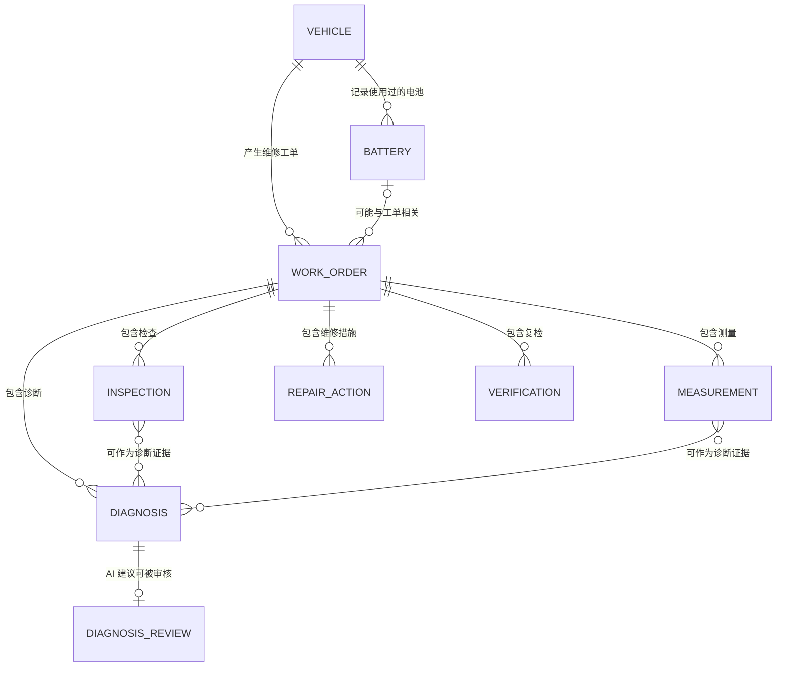

# 第 9 天：业务实体边界与概念 ER 图

## 1. 今日目标与建模边界

今天把 [CASE-001](./repair-workflow.md) 的维修流程转换为概念数据模型，回答两个问题：系统需要分别记录哪些业务对象，以及这些对象之间是什么关系。

本模型用于确认业务含义，不是 MySQL 表设计。今天不决定 SQL 类型、列名、外键约束、索引、级联删除或 ORM 实现。图中的“一”与“多”表达业务关系；对象在维修过程中可以逐步增加，因此刚创建的工单允许暂时没有检查、测量、诊断、维修或复检记录。

模型继续遵守以下证据边界：

- 只使用项目内匿名车辆代号，不采集姓名、手机号或车牌等无关个人信息。
- “未知”“待补充”和“未记录”保留原意，不能用数值 `0` 代替。
- 客户描述、检查观察、仪器测量、AI 建议、维修师判断、实际维修和复检结果分别记录。
- AI 输出属于待审核建议；维修师判断和修后复检也分别保留，不能由其中一项自动推导另一项。

## 2. 建模概念与实体边界

| 概念 | 在本项目中的含义 | 示例 |
|---|---|---|
| 实体 | 需要单独记录和追踪的一类业务对象 | 车辆、工单、检查记录 |
| 属性 | 描述某个实体的信息 | 工单的接车现象、检查的对象 |
| 标识 | 在项目内区分不同实体的唯一代号 | `V-001`、`WO-001`；这里只表达概念，不决定数据库主键类型 |
| 主键 | 数据库阶段用于唯一定位一条记录的字段 | 今天只确认每个实体需要唯一标识，不确定具体实现 |
| 外键 | 数据库阶段用于保存实体关联的字段 | 今天先确认“工单属于车辆”等关系，不确定字段名和约束 |
| 一对多 | 一个上级对象可以对应多条下级记录，每条下级记录只属于一个上级对象 | 一辆车可有多张工单，一张工单可有多条检查记录 |

一个信息是否应成为独立实体，主要检查三点：它是否有自己的生命周期，是否可能在同一工单中出现多次，以及是否需要单独追溯来源和结果。满足其中任一点时，就不宜只塞进工单的一段文本中。

## 3. 实体职责

| 实体 | 单独记录什么 | 为什么需要独立实体 | 允许缺失或出现多条的情况 |
|---|---|---|---|
| `Vehicle`（车辆） | 匿名车辆代号，以及实际已知且与维修相关的车辆信息 | 同一辆车可能多次进店，需要串联历史工单 | 每张工单必须属于一辆匿名车辆；车辆资料可以不完整 |
| `Battery`（电池） | 实际已知的电池身份、规格及信息来源 | 车辆可能更换电池，电池测量不能永久写死在车辆档案里 | 一辆车可暂时没有电池记录，也可在不同时期记录多块电池 |
| `WorkOrder`（维修工单） | 一次维修经历的接车现象、开始时间、当前进展和结束情况 | 同一车辆的不同维修必须分别形成闭环 | 一辆车可有多张工单；工单创建时只需具备接车信息 |
| `Inspection`（检查记录） | 检查对象、实际动作、观察结果、顺序以及来源 | “检查过”与“检查结果是什么”都需要追溯，且一次维修常有多项检查 | 一张工单可有零到多条；结果未提供时明确记为未知 |
| `Measurement`（测量记录） | 测量对象、项目、数值、单位、条件、时间和来源 | 仪器读数具有结构化数值和测量条件，不能与一般观察混为一段文字 | 一张工单可没有测量；有测量时可记录多次、多个测点 |
| `Diagnosis`（诊断记录） | AI 建议或维修师判断、结论阶段、证据来源和不确定项 | 初步判断、AI 建议和维修师最终判断可能不同，需要保留演变过程 | 一张工单可有零到多条；每条必须标明产生者及结论性质 |
| `DiagnosisReview`（诊断审核） | 维修师对某条 AI 建议的接受、修正或驳回，以及理由 | AI 输出不能直接成为已确认故障，审核决定需要独立追踪 | 仅 AI 诊断需要；每条 AI 诊断最多对应一条当前审核记录 |
| `RepairAction`（维修措施） | 实际实施的动作、更换或处理的部件及已知结果 | 建议做什么与实际做了什么含义不同，一次维修也可能执行多项措施 | 一张工单可有零到多条；未实施的建议不能写入此实体 |
| `Verification`（复检记录） | 修后检查项目、方法、观察或读数、结果及遗留问题 | 维修动作本身不能证明故障已解决，需要保存独立的效果证据 | 一张工单可有零到多条；未复检时不能默认维修成功 |

`Diagnosis` 同时容纳 AI 建议和维修师判断，但必须通过产生者和结论阶段区分。这样可以保留诊断演变，又不会把两类信息误当成同等可信。后续逻辑模型设计时，再决定是否需要拆成不同表或使用统一记录结构。

## 4. 概念 ER 图

关系基数说明：

| 关系 | 含义与边界 |
|---|---|
| `Vehicle 1 — 0..N WorkOrder` | 一辆车可能还没有维修记录，也可能多次进店；每张工单只描述一辆车的一次维修经历 |
| `Vehicle 1 — 0..N Battery` | 车辆可以没有已知电池资料，也可能因更换而形成多条电池记录；这里不推断当前电池 |
| `Battery 0..1 — 0..N WorkOrder` | 一张工单最多关联一块与本次维修有关的电池，也可以不涉及电池；同一电池可出现在多张历史工单中 |
| `WorkOrder 1 — 0..N 明细记录` | 检查、测量、诊断、维修措施和复检均随过程逐步添加；每条明细只属于一张工单 |
| `Inspection/Measurement 0..N — 0..N Diagnosis` | 一条诊断可引用多项证据，同一证据也可被初步判断和最终判断引用；具体关联实现留到逻辑模型阶段 |
| `Diagnosis 1 — 0..1 DiagnosisReview` | AI 建议在审核前可以没有审核记录，审核后最多保留一个当前审核结论；维修师本人产生的诊断不需要再次生成 AI 审核记录 |

图中没有画出“维修措施必然产生复检”的直接关系，因为实际流程可能中止或尚未复检。两者先通过工单归属保持关联；是否需要更细的措施与复检对应关系，等待更多真实案例后再决定。

## 5. CASE-001 走查

CASE-001 是转换器故障的历史维修案例。现有信息可以这样落入概念模型：

| 实体 | 本案例记录 | 证据边界 |
|---|---|---|
| `Vehicle` | 建立匿名车辆 `V-001` | 代号为建模示例；车型等资料未提供 |
| `Battery` | 不建立记录 | 本次没有电池身份或规格信息，也不是已确认的电池故障 |
| `WorkOrder` | 建立 `WO-001`，接车现象为灯、喇叭失效但仍可骑行 | 工单代号为示例；维修日期未提供 |
| `Inspection` | 三条记录：查看整车保险、检查灯光喇叭线束插头、检查转换器 | 检查动作已确认；逐项结果和严格先后未提供，不能补成“正常” |
| `Measurement` | 不建立记录 | 电压数值、测点、仪器和条件均未记录；不能写入 `0V` |
| `Diagnosis` | 一条维修师最终判断：灯和喇叭供电转换器烧坏 | 具体判定依据和烧坏根因未完整提供；本案例没有历史 AI 建议 |
| `DiagnosisReview` | 不建立记录 | 没有历史 AI 建议，因此不存在对 AI 建议的人工审核 |
| `RepairAction` | 两条记录：更换转换器；整理并包扎线路接头 | 部件规格和实施时间未提供 |
| `Verification` | 分别记录大灯、远近光、转向灯、喇叭的功能结果，并记录反复开关功能稳定 | 只能证明本次功能复检正常，不能扩大为整车安全或长期可靠性结论 |

这次走查说明：`Measurement` 数量为零时，工单仍可通过检查观察、维修师判断、实际措施和功能复检形成可追溯记录。反过来，电池维修可以关联 `Battery`，并在同一工单下保存不同测点、条件和时间的多条 `Measurement`，不会被固定为三串电芯结构。

## 6. 模型检查与待验收

### 模型检查

- [x] 九个实体各自承担一种业务职责，没有把整次维修压缩为一段无法追溯的文本。
- [x] CASE-001 在没有电池和电压测量记录时仍可完整表达。
- [x] 模型允许电池维修保存多次、多测点和带条件的测量。
- [x] 客户描述、诊断、审核、维修措施和复检结果不会互相自动替代。
- [x] 关系允许工单处于处理中，不会因暂时没有维修或复检记录而伪造结果。
- [x] 本文未确定 MySQL 表、字段类型、索引、外键约束或新增依赖。

### 学习验收

以下问题需要学习者在不照抄实体表的情况下独立解释，完成后再标记通过：

1. 为什么车辆和维修工单是一对多，而不是把每次维修直接覆盖在车辆记录中？
2. 为什么检查记录和测量记录要分开？
3. 为什么维修措施和复检结果不能合并成同一条记录？
4. 为什么 AI 建议还需要单独的维修师审核记录？

- [x] 能解释车辆与工单的一对多关系。
- [x] 能解释检查与测量的不同数据语义和证据要求。
- [x] 能解释维修动作与效果证据的区别。
- [x] 能解释 AI 建议、人工决策和责任边界。

验收过程保留提示边界：第 1、3 题直接通过；第 2 题最初错误地认为检查一定发生在测量之前，经场景纠正后能说明两者记录内容和证据形式不同、可以独立存在；第 4 题最初只说明需要人工审核，随后在“AI 建议更换电池、维修师确认接头松动”的新场景中，能独立拆分诊断、审核、维修措施和复检，并说明保留 AI 原建议用于评估其可靠性。

完成学习验收只代表能够解释本版概念模型。它不代表数据库设计、真实业务覆盖度或 AI 诊断准确性已经验证。
