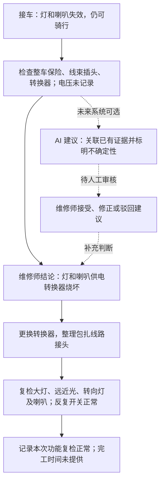

# 第 8 天：匿名维修流程与必要字段

## 1. 目标与证据状态

目标：依据维修师实际处理过的一次维修，整理接车、检查、判断、维修、复检的过程，为后续业务建模提供依据。

2026-10-14 收到一条真实维修经历：车灯、喇叭失效但车辆仍可骑行，更换转换器并整理包扎线路接头后，灯光及喇叭功能复检正常。来源为用户转述，用户明确表示提供的内容均已由父亲（维修师）确认；没有收到原始测量记录。下文只记录已提供事实，字段的必要性仍为设计建议；今天不确定 SQL 类型、索引或表结构。

- 真实案例：CASE-001，灯光与喇叭供电转换器故障。
- 维修师确认：用户表示本次提供的故障、检查、维修及复检内容均已由父亲确认；未提供的细节不视为已确认。
- 第 7 天知识复述：已进行本聊天简短复习，具体回答及提示边界记录在本地进度文件。
- 案例走查：已按现有叙述核对信息链，缺失项见第 5 节；第 8 天三个设计问题已完成独立复述。

记录时区分客户描述、实际测量、维修师判断和未来 AI 建议。不收集姓名、手机号、车牌等无关个人信息；编号为项目内匿名代号。

尚未询问的信息写“待补充”；询问后确定没有记录的数值写“未记录”，不以 0 代替。回忆或转述标明来源及“待维修师确认”，不能写成已经核实的事实。

## 2. 一条真实案例的采集记录

案例代号：CASE-001。采集日期：2026-10-14（不是维修日期，维修日期未提供）。

| 环节 | 访谈问题 | 实际案例内容 | 来源与确认情况 |
|---|---|---|---|
| 背景 | 大致何时维修？车辆、电池哪些信息当时确实知道？ | 维修日期、车型、电池及转换器规格未提供 | 待补充，不推断 |
| 接车 | 客户报告什么现象？ | 车灯、喇叭全都失效，但是车子还可以正常骑行 | 用户转述；据用户说明，已由维修师确认 |
| 检查 | 做过哪些检查？各项结果是什么？ | 查看整车保险；检查灯光喇叭线束插头；检查转换器。按用户列举顺序记录，逐项结果及严格操作先后未提供 | 检查动作据用户说明已确认；不写成保险、插头均正常 |
| 测量 | 读数、单位、测点、仪器及条件是什么？ | 电压数值未记录；具体测点、仪器及测量条件未提供 | “数值未记录”据用户说明已确认；不补输入或输出电压 |
| 初步判断 | 曾怀疑什么？是否改变判断？ | 中间假设、排除过程未提供 | 待补充，不把最终结论当作最初判断 |
| 最终判断 | 最后确认什么问题？ | 负责灯和喇叭供电的转换器烧坏；导致其烧坏的根本原因未提供 | 故障结论据用户说明已由维修师确认；具体判定依据未完整提供 |
| 实施维修 | 实际做了什么？ | 更换新的转换器，整理包扎好线路接头 | 用户转述；据用户说明，已由维修师确认 |
| 复检 | 如何验证功能？ | 开启大灯、远近光、转向灯，全部正常点亮；按喇叭响声正常；反复开关测试功能稳定。次数、持续时长未提供 | 用户转述；据用户说明，已由维修师确认 |
| 完工 | 目前能确认什么结果？ | 本次灯光、喇叭功能修后复检正常；完工时间、交车及长期使用情况未提供 | 仅确认上述功能复检结果，不扩大为整车安全或长期可靠性结论 |

本表记录实际发生的维修，不替维修师补写检查步骤或安全结论。现有三串电芯模拟器的数据不能冒充这次维修的测量数据，真实电池也不默认采用三串结构。

## 3. 本案例流程与未来 AI 位置

实线整理本案例已提供的主要环节，不表示其他故障也必须按同样步骤维修。检查节点内的动作按用户列举顺序保留，不推断每项检查结果或严格操作先后。

虚线是未来系统的设计建议。本次叙述未包含 AI 参与，不记录历史 AI 建议或人工审核 AI 的结果。未来 AI 建议、人工审核意见和实际维修结果分别记录；接受某条建议也不等于已经证明维修成功，仍需复检证据。

## 4. 必要字段候选清单

下表是业务信息清单，不是一字段对应一列的建表方案。“必需”为设计建议，仍待业务核对。标有“本例”的内容来自第 2 节；代号仅作设计示例，其余填写说明不是实测数据。该案例说明检查观察和功能复检也需要记录，不能强制每次维修都有电芯电压数据。

| 环节 / 信息 | 含义 | 匿名示例或填写方式 | 信息来源 | 是否必需（候选） | 使用目的 |
|---|---|---|---|---|---|
| 车辆代号 | 区分车辆的项目内编号 | V-001（示例） | 未来系统分配 | 是 | 关联同一车辆的多次维修 |
| 已知车辆信息 | 维修相关的类型、型号等 | 按实际已知情况；不清楚写未知 | 维修师观察、铭牌、客户陈述，分别注明 | 按维修需要 | 提供诊断背景 |
| 电池信息 | 已知电池类型、规格及来源 | 铭牌可确认项；未知不推断 | 铭牌、维修师观察或客户陈述 | 涉及电池时记录已知项 | 避免将模拟器结构套用到实车 |
| 工单代号 | 区分一次维修经历 | WO-001（示例），关联 V-001 | 未来系统分配 | 是 | 将同次检查、判断、维修串联 |
| 接车时间 | 维修开始的大致或准确时间 | 据实记录；回忆仅知月份则注明 | 当时记录或维修师回忆 | 新工单必需；历史缺失注明 | 支持时间顺序和历史查询 |
| 故障描述与触发情境 | 客户报告的现象及发生条件 | 本例：灯、喇叭失效，车辆仍可骑行；触发条件未提供 | 客户陈述，由维修师或用户转述 | 是 | 保留问题起点 |
| 检查记录 | 每次实际检查的对象、顺序和观察 | 本例：检查整车保险、线束插头、转换器；逐项结果未提供 | 维修师观察或当时记录 | 有检查就记录 | 追溯判断依据；区分做过检查与检查结果 |
| 测量对象与项目 | 具体测的什么、哪个位置 | 据实命名，不预设 cell1–cell3 | 维修师、仪器或采集设备 | 有测量时必需 | 防止混淆不同位置的读数 |
| 测量值与单位 | 实际读数及对应单位 | 本例：电压数值未记录；不填 0 或猜测电压 | 仪器读数或原始日志；本例仅有转述 | 有读数时记录；缺失注明 | 使数值可解释，不补造数据 |
| 测量条件、方法与时间 | 读数产生的情境及先后 | 维修师描述；不清楚写未知 | 维修师、仪器或采集设备 | 有测量时记录已知项 | 区分修前、修后及不同条件 |
| 初步判断、依据与不确定项 | 当前怀疑及支持或缺失的证据 | 分开填写怀疑原因和依据 | 维修师判断 | 有判断时必需 | 避免把猜测当作最终故障 |
| 最终故障与确认依据 | 维修师最终确认的结果 | 本例：转换器烧坏；具体判定依据待补充，烧坏根因未知 | 维修师及关联检查、复检记录 | 完工时记录确认情况 | 区分初步判断、最终故障及损坏根因 |
| 实际维修措施与部件 | 实际实施的动作及更换情况 | 本例：更换转换器，整理包扎线路接头；部件规格未提供 | 维修师及维修记录 | 实施维修时必需 | 解释具体做了什么 |
| 复检方法、结果与遗留问题 | 如何验证以及实际观察结果 | 本例：各灯正常点亮、喇叭响声正常、反复开关稳定 | 维修师复检或原始测量 | 声明修复完成时必需 | 为维修效果提供证据；区分观察结果与测量数值 |
| 当前进展与结束时间 | 目前停在哪一步、是否完工 | 据实描述；未完工记录原因 | 维修师及未来系统记录 | 进展必需；结束时间视情况 | 避免把中止维修算作成功 |
| 来源与确认情况 | 每项事实从何而来、是否核实 | 用户回忆／爸爸转述／原始记录；待确认／已确认 | 提供者及维修师反馈 | 是，适用于各项记录 | 区分事实、回忆和设计建议 |
| AI 建议及证据引用（未来） | 模型建议、所用测量与知识来源 | 本次叙述未包含 AI 建议，不填入历史案例 | 未来 Agent 输出 | 实际调用 AI 时才记录 | 支持追溯，避免伪造历史 AI 参与 |
| 人工审核（未来） | 对某次 AI 建议的接受、修正或驳回及理由 | 本次留空，不预填为接受 | 维修师 | 使用 AI 建议的流程需要 | 保留人工决策与模型输出的区别 |

候选关系为同一车辆可对应多次维修，一次维修可对应多条检查、测量及复检记录。本例支持一次维修有多个检查动作和复检项目，但不能单凭这一条案例声称已验证返修或多工单流程；后续通过场景走查确认，不直接建表。

## 5. 走查、待确认问题与验收

已按用户叙述完成一次文档走查：

| 核对项 | 本例证据及边界 |
|---|---|
| 故障描述能否保留 | 同时保留灯、喇叭失效与仍可骑行；不自动归因为电池故障 |
| 检查和测量能否表达 | 三类检查动作可记录；逐项结果未提供，电压未记录，不能伪造完整排查证据 |
| 判断能否追溯 | 能追溯到维修师确认的转换器故障结论；具体测量判定依据尚不完整 |
| 措施是否具体 | 更换转换器与整理包扎线路接头分别保留，不遗漏第二项措施 |
| 修后结果是否有支撑 | 有灯光、喇叭逐项功能复检及反复开关结果；不扩大到长期稳定或整车安全 |
| 字段是否过度依赖电芯数据 | 本例不提供电芯数据仍能描述维修；测量不是唯一证据来源 |
| 是否有虚构历史 AI 参与 | 没有；AI 位置只列为未来设计 |

优先待确认：

1. 如还能回忆，检查整车保险、线束插头时分别发现了什么？依据什么确定转换器损坏？不要求补造已遗失的电压数值。
2. 维修日期、车辆和转换器规格、测量条件未提供；可补则补，无法确认时保留未知，不用采集日期替代维修日期。
3. 本例未交代损坏根因、复检次数及长期使用情况，不能据此推断。
4. 候选字段哪些在日常维修中确实需要、哪些多余？业务必要性仍待后续案例核对。

验收清单：

- [x] 收到一条匿名真实维修经历，并标注用户转述、据用户说明已由维修师确认。
- [x] 依据案例修订流程图，区分实际流程和未来 AI 接入。
- [x] 将已知事实对应到候选字段，明确缺失项；字段必要性仍待业务核对。
- [x] 用案例从接车走查到功能复检，不扩大为整车安全、交车或长期效果已验证。
- [x] 用户独立解释“一辆车为什么有多张工单”：保留同一车辆编号，另建工单以保存历史维修数据。
- [x] 用户独立解释“客户描述、测量、AI 建议、维修师结论为什么分开”：用于追溯信息来源，避免把 AI 猜测或客户描述当作已确认事实。
- [x] 用户独立解释“如何证明做过什么、如何验证效果”：记录实际维修措施、复检方法及结果，形成维修闭环。

后两题先经过引导练习，随后用户在无提示的综合复述中独立说明了信息来源分离和维修闭环；最终验收以该次复述为依据。

本次完成案例采集、文档走查和学习验收，但不代表历史案例已有完整测量证据。保留缺失信息，后续数据库设计另行安排。
